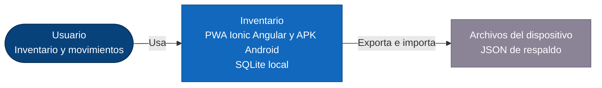
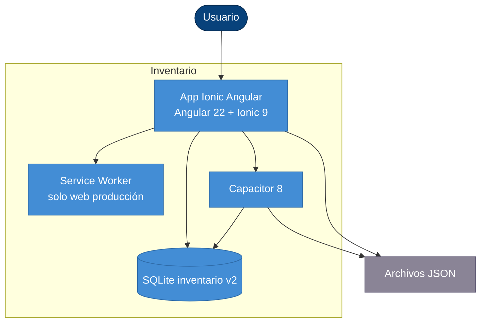

# Inventario

App **Ionic Angular + Capacitor** (PWA y Android) para **gestión de inventario**: productos por categoría y marca (según proveedor), entradas, salidas, ajustes, costo promedio y reportes. Los datos viven en **SQLite local** y se exportan o restauran como JSON v2.

Arquitectura, esquema y reglas de stock: **[Manual técnico](docs/manual-tecnico.md)**.

## Arquitectura (modelo C4)

El sistema es **offline-first**: no hay API remota. El intercambio externo es un archivo JSON de respaldo.

### Nivel 1 — Contexto



### Nivel 2 — Contenedores



### Nivel 3 — Componentes (resumen)

| Capa | Componente | Archivo |
| --- | --- | --- |
| Shell | `AppComponent`, `TabsPage` | `src/app/` |
| UI | `DashboardPage` | `features/dashboard/` |
| UI | Productos (lista, detalle, formulario) | `features/products/` |
| UI | Movimientos | `features/movements/` |
| UI | Catálogos (proveedores, marcas, categorías) | `features/catalogs/` |
| UI | `ReportsPage`, `SettingsPage` | `features/reports/`, `settings/` |
| Dominio | `ProductService`, `StockMovementService`, `ReportService`, catálogos | junto a cada feature |
| Core | `DatabaseService`, `inventory-math`, `BackupService`, `ThemeService` | `src/app/core/` |

## Requisitos

- Node.js
- JDK 21 (Homebrew `openjdk@21`) para Android

```bash
npm install
```

## Desarrollo

```bash
npm start
```

Abre `http://localhost:4200`.

## Android

```bash
npm run android:apk
```

APK debug: `android/app/build/outputs/apk/debug/app_inventario.apk`

## Uso

1. En **Ajustes → Catálogos**, crea proveedores, marcas y categorías.
2. Registra **productos** (SKU, categoría, marca).
3. En **Operaciones**, registra **ventas** (ticket), **compras** o movimientos sueltos (entrada/salida/ajuste).
4. Asigna **fotos** a productos y marcas; usa **código de barras** en Android o lector USB en web.
5. Revisa **Inicio** y **Reportes** (incluye CSV de inventario, movimientos y ventas).
6. Exporta o restaura respaldo JSON v3 en Ajustes.

## Scripts

| Comando | Descripción |
| --- | --- |
| `npm start` | Servidor `:4200` |
| `npm run build` | Build a `www/` |
| `npm run android:apk` | APK debug |
| `npm test` | Vitest |
| `npm run lint` | ESLint |

## Documentación

| Documento | Contenido |
| --- | --- |
| Este README | Uso, scripts, C4 |
| [docs/manual-tecnico.md](docs/manual-tecnico.md) | Esquema v2, stock, reportes, respaldo |
